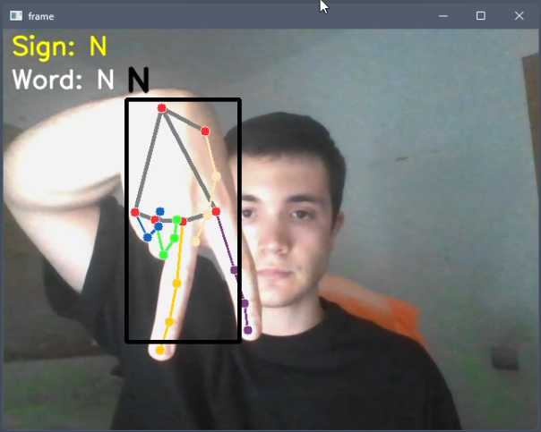

# ASL Hand Gesture Recognition

**A real-time webcam recognizer for the American Sign Language (ASL) alphabet that turns held hand signs into letters and words, with a Random Forest and a Keras neural network as interchangeable classifiers.**

> **Context.** Built in July 2025 as a personal project, one of my first public repositories, while I was studying Computer Engineering at UPV and had just finished working as a guide at the UPV Computer Museum. It is a small, complete machine learning pipeline (collect, extract, train, infer) written before I worked at Grupo CEU or Auro AI and before I used coding agents; it is kept as it was written and the code is not maintained.



The `photos/` folder holds one capture per recognized state (N, A, C, H, O and BLANK).

## What it does

- Recognizes the 26 letters of the ASL alphabet plus a `BLANK` class (no hand) from the webcam in real time.
- Draws the MediaPipe hand landmarks, a bounding box and the predicted letter on the video frame.
- Builds words: a letter is appended after the same sign is held for 3 seconds, and the word is cleared after `BLANK` is held for 5 seconds.
- Keyboard controls: `q` quits, `c` deletes the last character, space adds a space.
- Includes every step of the pipeline as a script: image collection, dataset creation, training and inference.
- Offers two classifiers over the same features: a scikit-learn `RandomForestClassifier` and a Keras dense network.

## How it works

1. `collect_imgs.py` captures 500 webcam frames for each of the 27 classes (A to Z and BLANK) into `data/<class>/`.
2. `create_dataset.py` runs MediaPipe Hands on every image, takes the 21 hand landmarks, and normalizes the x and y coordinates by the bounding box of the landmarks (42 features per sample). `BLANK` images where no hand is found become a vector of zeros. The result is saved to `data.pickle`.
3. `train_classifier.py` splits the data 80/20 (stratified, `random_state=42`), fits a `RandomForestClassifier` and saves it with its `LabelEncoder` to `model.p`.
4. `train_deep_classifier.py` trains a Keras `Sequential` model (Dense 128, Dropout 0.3, Dense 64, Dropout 0.3, softmax output) for 50 epochs with batch size 32 and saves `deep_model.h5` and `label_encoder.pkl`.
5. `inference_classifier.py` and `deep_inference_classifier.py` read the webcam, extract and normalize the landmarks the same way, predict with the chosen model and apply the word-building timers.

## Results

The repository does not contain evaluation output (no logs, metrics or reports). The training scripts print test accuracy when run, but no numbers are recorded here. The repository does ship pre-trained files (`data.pickle`, `model.p`, `deep_model.h5`, `label_encoder.pkl`).

## Run it

Not run again while writing this README; the commands come from the scripts and `requirements.txt`. Needs a webcam. Python 3.9 in a conda environment is what the previous README recommended; no other Python version was checked.

```bash
conda create --name sign_language python=3.9
conda activate sign_language
pip install -r requirements.txt

python collect_imgs.py          # press Q to start each letter, 500 images per class
python create_dataset.py        # writes data.pickle

python train_classifier.py      # Random Forest, writes model.p
python inference_classifier.py

# or the neural network
python train_deep_classifier.py # writes deep_model.h5 and label_encoder.pkl
python deep_inference_classifier.py
```

The repository ships `data.pickle`, `model.p`, `deep_model.h5` and `label_encoder.pkl`, so the collection, dataset and training commands can be skipped to try the inference scripts directly. How well they generalize to another camera or setup was not tested.

## Repository layout

```
collect_imgs.py                # capture training images from the webcam
create_dataset.py              # MediaPipe landmarks to normalized features (data.pickle)
train_classifier.py            # Random Forest training (model.p)
train_deep_classifier.py       # Keras training (deep_model.h5, label_encoder.pkl)
inference_classifier.py        # real-time inference with the Random Forest
deep_inference_classifier.py   # real-time inference with the Keras model
requirements.txt               # pinned dependencies
photos/                        # demo captures (N, A, C, H, O, BLANK)
```

## Stack

Python, MediaPipe Hands, OpenCV, scikit-learn, TensorFlow/Keras, NumPy.
